<p align="center">
  
</p>

<p align="center"><strong>A Shinchan-led evidence mystery game about what the sources say, where they disagree, and what still needs checking.</strong></p>

<p align="center"><em>No public deployment is configured. Run the complete app locally; no account or API key is required for the rule-based experience.</em></p>

<p align="center">
  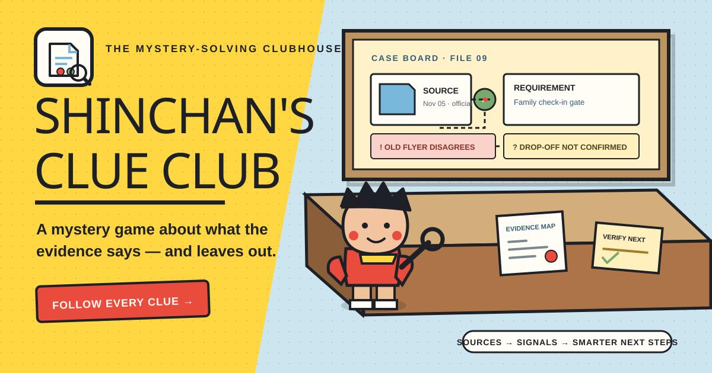
</p>

## The problem this project tackles

Information is often scattered across notices, web pages, documents, and informal messages. Finding a summary does not answer the harder questions: **which details are missing, which records disagree, is a source dated, and what should someone verify next?** The hackathon problem statement calls this a **Digital Dark Spot**.

**Shinchan's Clue Club** turns a research question into an inspectable case. It preserves source records, connects exact passages to requirements, flags potential conflicts and date uncertainty, and creates a human-owned verification mission. Shinchan is the guide through a real investigation workflow—not decoration around a generic dashboard.

## How to run locally (Windows)

**Requirements:** Python 3.11+ and Node.js 20.19+.

Open PowerShell in the project folder and run:

```powershell
.\setup.ps1
.\run.ps1
```

`setup.ps1` installs the Python and Node dependencies and creates the local backend settings file. `run.ps1` starts both the API and web app. Then open **http://localhost:5173**. The API runs on **http://localhost:8000**; its interactive docs are at **http://localhost:8000/docs**. The rule-based experience works without an API key.

Optional AI extraction can be enabled by setting `OPENAI_API_KEY` and `OPENAI_MODEL` in `backend/.env`. The key stays on the backend. When enabled, source text is sent to the OpenAI API for advisory extraction; candidate quotations are checked against the stored source snapshot.

## Hackathon problem → implementation

| Expected outcome | What Clue Club does | Where to see it |
|---|---|---|
| Accept a topic, question, or research goal | Case creation saves the decision question, context, and editable checks | New Case → case workspace |
| Gather more than one source | Source Locker accepts public pages, pasted excerpts, PDF, DOCX, TXT, and Markdown | School-Fair case → Source Locker |
| Summarize source material in a structured way | Claim Workshop and Case Briefing show source snapshots, metadata, and traceable passages | Stations 4 and 8 |
| Identify missing details and unanswered questions | Requirement coverage distinguishes covered, partial, conflicting, not found, and not reviewed | Claim Workshop and Requirement Studio |
| Identify possible contradictions with record references | Conflict Lab displays the competing excerpts, source dates, and a suggested fact to confirm | Station 5 |
| Flag old or undated information | Case Timeline and freshness signals retain publication and capture dates, including unknown dates | Stations 2 and 5 |
| Produce a prioritized verification checklist | Findings create editable tasks with status, notes, evidence, and a suggested next check | Mission Board, station 7 |
| Separate evidence from suggestions and uncertainty | Quotes are checked against stored text; rule-based and optional AI-assisted analysis are labeled; “not found” stays scoped to reviewed records | Claim Workshop, map inspector, and briefing |

## What is in the project

### Five connected features

1. **Living 3D Evidence Map.** An interactive Three.js / React Three Fiber desk uses the active case data to arrange source folders, requirement markers, gap/conflict/freshness signals, and verification tasks. Colored threads show their relationships. Select a node to open its source or signal in the inspector. A keyboard-accessible 2D evidence list exposes the same records when WebGL is unavailable.
2. **Source Locker and provenance pipeline.** Import a web page, a file, or a pasted excerpt. Each record keeps its stable ID, case, title, type, publisher when known, original URL or filename, publication date, capture time, extracted text, and SHA-256 snapshot hash. Markdown frontmatter can supply a title, publisher, and date.
3. **Digital Dark Spot coverage.** The engine checks each requirement against the reviewed source set. Coverage explains the status, cited passages, reason, and next step. “Not found” means **not found in this case's reviewed sources**; it is never a claim that something does not exist.
4. **Conflict and Freshness Lab.** Candidate disagreements appear as exact source excerpts with dates and a suggested check. A manual comparison bench works for any two records, and the case timeline separates publication history from capture and patrol activity.
5. **Verification Mission and solvable mystery.** Signals can become tasks that people mark open, in progress, verified, or dismissed and annotate with a note. Four unsolved Shinchan-themed challenge files open without a prefilled analysis. The School-Fair case adds a progressive hint route, a backend-held verdict, attempts and feedback, a sourced resolution, and an honest remaining gap.

### Three independent clubhouse workspaces

These are separate browser routes with their own workflows, filters, empty states, and animated 3D Shinchan companion. They are not tabs embedded in a case station:

| Route | Workspace | What detectives do there |
|---|---|---|
| `/case-files` | Case Files | Search saved cases and the case library, filter unsolved versus guided mysteries, and open a case at its investigation station. |
| `/mission-control` | Mission Control | Review open, in-progress, verified, and dismissed checks across all cases. Expand source-linked passages, record detective notes, update task status, and jump directly to the task in its owning case. |
| `/evidence-vault` | Evidence Vault | Search source snapshots across cases, read captured text and SHA-256 provenance, and explicitly copy a source into another case. Reuse keeps the original case/source lineage and is idempotent. |

Case stations also have addressable URLs (`/cases/{case_id}/{station}`), so a selected mission can deep-link to the right case and station and still work after refresh. Top navigation connects the standalone workspaces to the existing clubhouse, How to Play lessons, and case investigation flow.

### The complete playable demo: *Shinchan and the Great School-Fair Switcheroo*

This is an explicitly fictional training mystery. The people, school, event, dates, and records are invented; it is not school or accessibility guidance.

**The question:** For Futaba Kindergarten's family science fair on November 7, which entrance, check-in time, and wristband should a family use; what does the access note say; and what still needs confirmation?

The unsolved case starts with three records: an October 20 family flyer, a November 5 revised organizer bulletin, and an undated, unverified parent-chat rumor. The player downloads `frontend/public/sample-files/fair-access-update.md` and imports it through Source Locker. That real upload adds the fictional November 6 access update and its frontmatter metadata to the case.

After the patrol, the evidence chain should show:

- **Potential conflicts:** the old flyer and undated rumor disagree with the dated organizer bulletin about the family entrance, check-in time, and wristband. The bus departure is a separate detail, not the check-in time.
- **Supported details:** the organizer bulletin says East Library Gate, 9:20 AM, a blue wristband, and a 9:35 AM bus departure; the uploaded access update says the step-free ramp at East Library Gate opens at 9:15 AM.
- **Still not found:** accessible parking and vehicle drop-off arrangements are not confirmed in the reviewed records. The Verification Mission keeps an open task to ask the fictional event desk.

The evidence-backed verdict is one complete plan from the dated organizer bulletin and access update. A correct verdict reveals the record-based explanation; a wrong answer does not expose the answer key. Exporting the Markdown briefing keeps the parking/drop-off detail marked for confirmation.

### Two-minute judge demo

1. From **Shinchan's Unsolved Files**, open *Shinchan and the Great School-Fair Switcheroo*. Every opening creates a fresh copy, so a judge can replay it.
2. In **Source Locker**, inspect the October flyer, revised bulletin, and undated rumor. Select **Download note**, then **Upload note** and add `fair-access-update.md` through the file control.
3. Select **Run the patrol**. The app opens the 3D Evidence Map, where the case's source, requirement, signal, and task objects are connected. Select a conflict or gap and inspect its source references.
4. Open **Conflict Lab** to compare dated passages and the rumor. Open **Requirement Studio** to trace the still-unconfirmed access arrangement.
5. In **Mission Board**, submit the evidence-backed plan. Shinchan offers progressive hints on request; the answer remains hidden until a correct verdict.
6. Open **Case Briefing** and show that accessible parking/drop-off is still an open confirmation task. Use **Download .md** to export the source-linked report.

There are no sample credentials. The app's rule-based case path works without an OpenAI key.

## Screenshots from the running app

These are genuine local browser captures of the implementation. The final screenshot is a 390 px mobile-width capture.

| Screen | Capture |
|---|---|
| Detective HQ and animated Shinchan welcome | 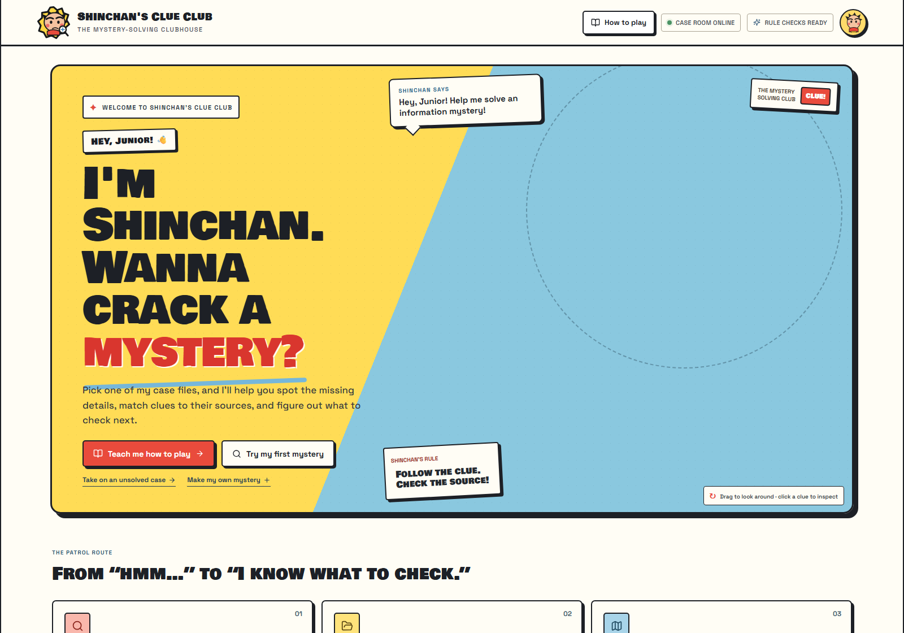 |
| School-Fair case and real bonus-file import prompt | 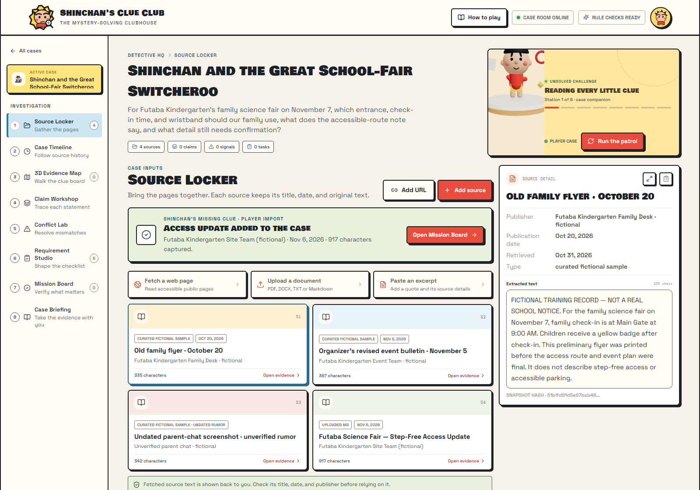 |
| Connected 3D desk and evidence inspector | 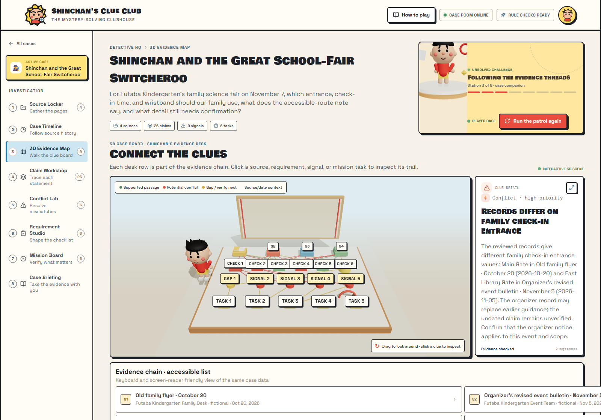 |
| Source comparison | 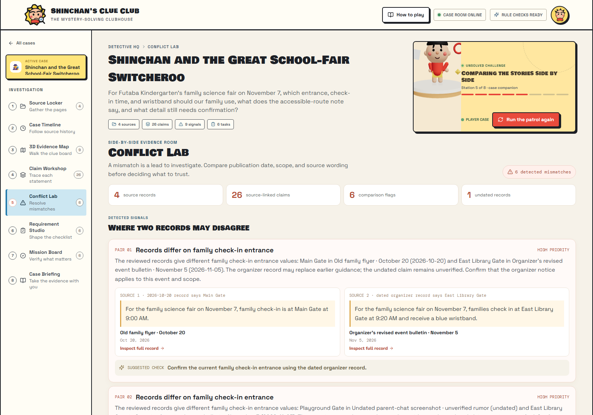 |
| Correct verdict and mission | 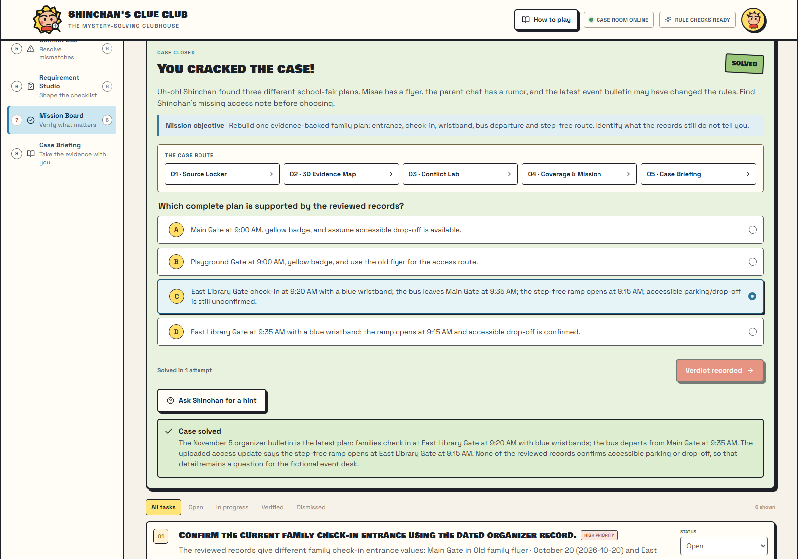 |
| Exportable briefing with unresolved access gap | 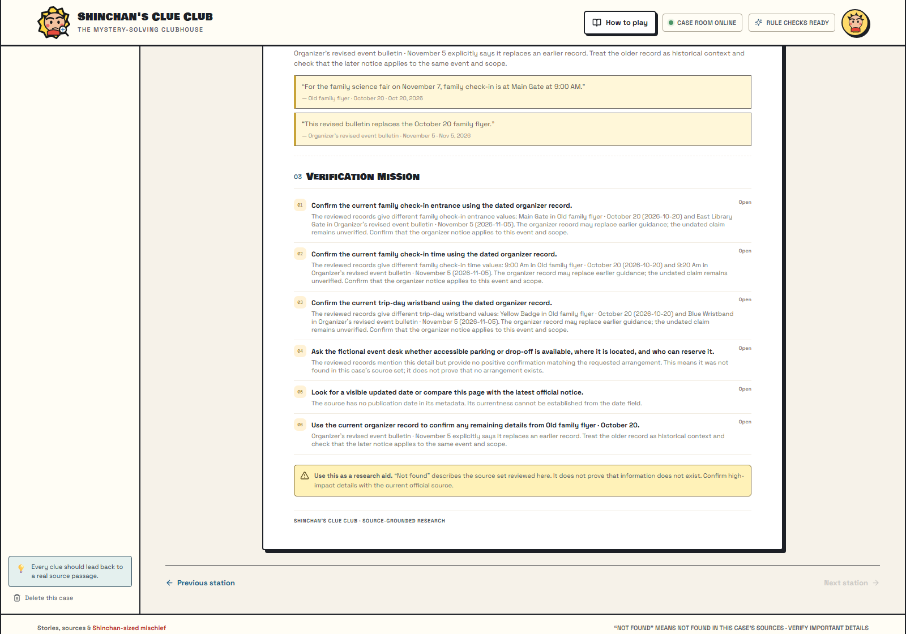 |
| Narrow mobile layout | 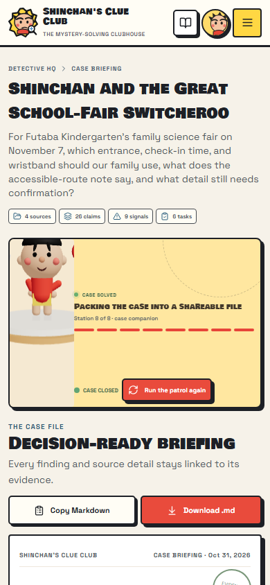 |

## Brand and visual language

The UI uses the project's comic-book clubhouse style, large **Bowlby One SC** headlines, **Space Grotesk** body text, bold ink outlines, warm paper surfaces, and flat colors. It avoids neon orange glow and decorative dashboard chrome.

| Token | Hex | Meaning |
|---|---|---|
| Ink | `#1d2026` | Text, outlines, and diagram lines |
| Paper | `#fffdf5` | Main surfaces |
| Cream | `#f6f0df` | Secondary surfaces |
| Red | `#e94b3c` | Primary action and potential conflict |
| Yellow | `#ffd743` | Shinchan accent and key clue |
| Blue | `#76b7da` | Source and date context |
| Green | `#79a96d` | Supported or covered |
| Gold | `#d7ad39` | Gap or verify next |
| Muted | `#5f6470` | Secondary text |

Project artwork lives in [`assets/brand`](assets/brand): the clubhouse wordmark and 1200×630 project thumbnail are original SVG artwork. [`frontend/public/favicon.svg`](frontend/public/favicon.svg) is the browser mark. Shinchan's 3D scene is made from procedural geometry; there is no downloaded character model.

## Architecture

### System map

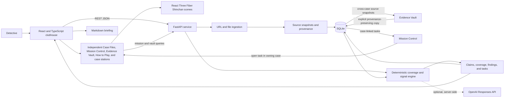

### Import-to-verdict sequence

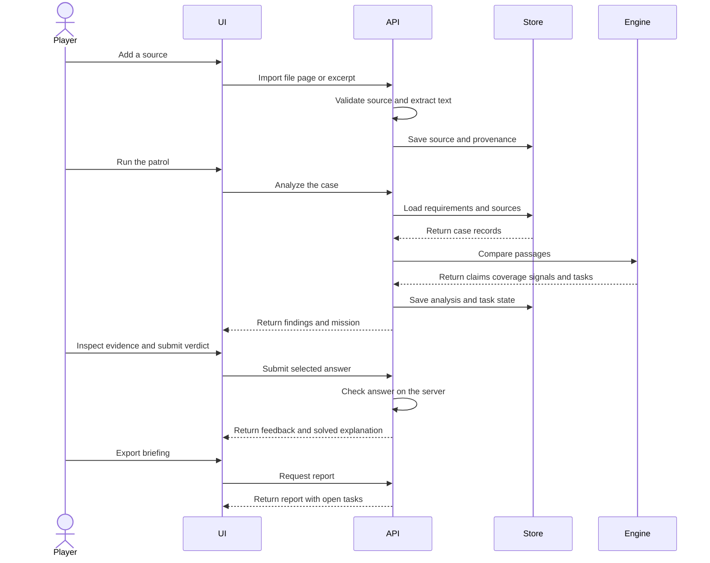

### Data relationships

The main case/source/run/task records are SQLite rows. Claims, requirement coverage, findings, and their exact source references are preserved inside each analysis run's JSON result, so a later run does not discard the original result. Challenge solution state is stored with the case and filtered from public responses until solved.

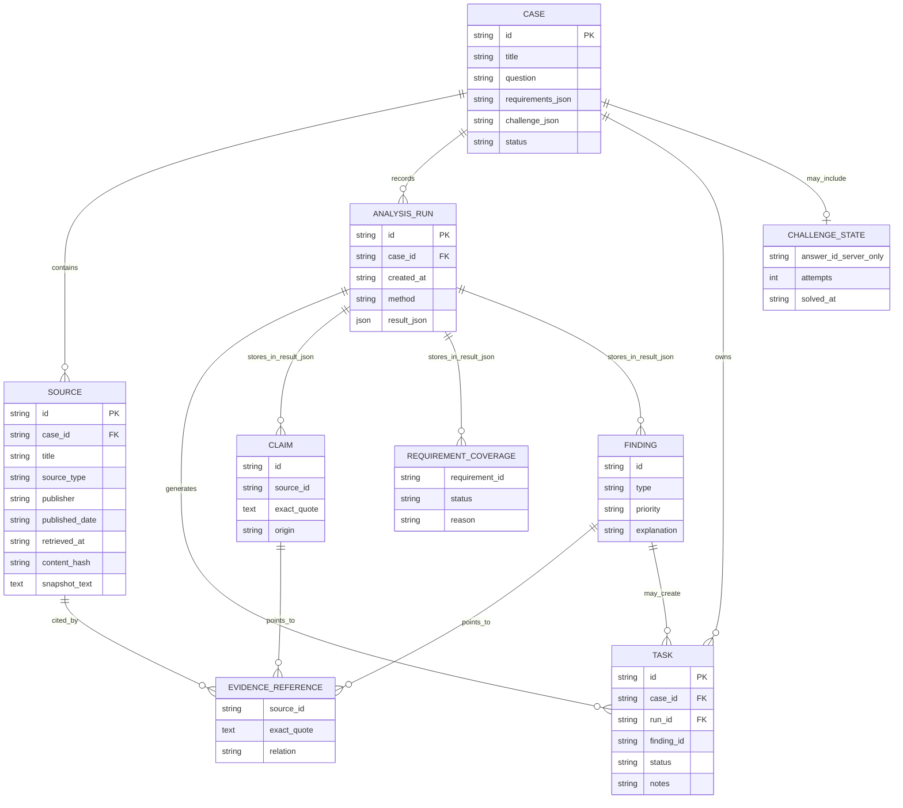

## Tech stack and repository map

- **Frontend:** React 19, TypeScript, Vite, Framer Motion, Lucide React
- **3D:** Three.js and React Three Fiber / Drei, with reduced-motion support and an HTML evidence fallback
- **Backend:** Python 3.11+, FastAPI, Pydantic, HTTPX, Beautiful Soup, pypdf, python-docx-style extraction from DOCX XML
- **Persistence:** SQLite; cases, source snapshots, analysis runs, and verification tasks are stored locally
- **Optional AI:** OpenAI Responses API structured extraction, only when configured on the server

```text
sinchanHackathon/
├── frontend/
│   ├── public/sample-files/       Fictional player-import file
│   └── src/                       Independent pages, case stations, evidence UI and 3D Shinchan
│       ├── ClubhousePages.tsx     Case Files, Mission Control, and Evidence Vault
│       └── club-pages.css         Responsive workspace layouts and route navigation
├── backend/
│   ├── main.py                    FastAPI case, mission, vault, import, challenge, and report endpoints
│   ├── engine.py                  Deterministic claims, coverage, signals, and tasks
│   ├── database.py                SQLite schema, migrations, and persistence
│   ├── catalog.json               Eight guided mystery files
│   ├── challenge_cases.json       Four unsolved case templates; answers stay server-side
│   └── tests/test_demo_case.py    API and demo-case regression tests
├── assets/
│   ├── brand/                     Logo and share thumbnail SVGs
│   └── screenshots/               Genuine desktop and mobile captures
├── data/                          Local SQLite database created on first run
├── setup.ps1                      Install dependencies on Windows
├── run.ps1                        Start the frontend and API together
├── PROJECT_BLUEPRINT.md           Product and architecture blueprint
├── CASE_ARCHIVE.md                Sample mystery archive
├── SHINCHAN_3D_DESIGN_SPEC.md     3D art and interaction direction
└── FEATURES_DEMO_AND_README_BUILD_PROMPT.md
```

The guided archive includes **8 mysteries and 24 fictional source records**. The unsolved challenge library contains **4 files and 15 starting fictional records**, plus the School-Fair player's separate Markdown import.

## Safety, privacy, and limits

- The demo records are fictional. Do not use them as school, scholarship, accessibility, transport, or legal guidance.
- Source content is untrusted data. Imported HTML is parsed into text, not executed.
- URL fetch accepts HTTP/HTTPS on standard ports, rejects local/private/reserved address targets, revalidates each redirect, uses timeouts, and caps fetched content at 7 MB. Uploads accept PDF, DOCX, TXT, or Markdown up to 8 MB; extracted text is capped at 250,000 characters.
- Source snapshots and user cases are stored in the local SQLite file (`data/kasukabe.db` by default). The project has no accounts, cloud sync, or multi-user authorization. Keep the local instance private; it is not configured as a production multi-user service.
- Rule matching is deterministic and deliberately cautious, but it is not a substitute for human review. Language and scope can be ambiguous; a signal is a lead, not a verdict about which source is true.
- The 3D scene respects the device's reduced-motion setting. If WebGL cannot run, the 2D evidence list and inspector remain available. Local profile preferences include character look, reduced motion, and high-contrast ink mode.
- A hosted deployment is **not configured** and no public demo URL is available. A deployment would need a persistent database, correctly restricted CORS, server-side secrets, and authentication/rate limits before public exposure.

## Verification

The following checks were run for this project state:

```powershell
npm run build
.\.venv\Scripts\python.exe -m compileall -q backend
.\.venv\Scripts\python.exe -m unittest discover -s backend/tests -v
```

**Result:** frontend production build passed; backend compile passed; all 3 demo API regression tests passed. A local browser walkthrough also imported the Markdown clue through Source Locker, ran analysis, submitted the answer, and opened the report. Desktop captures were reviewed and a 390 px mobile view reported no horizontal overflow. The production build prints a Vite chunk-size advisory for the 3D dependencies; it does not fail the build.

## Attribution and license

The logo, thumbnail, sample records, interface, and procedural 3D scene are authored for this project. The UI uses Google Fonts (Bowlby One SC and Space Grotesk) and Lucide React icons; third-party package details are in the package manifests. The repository includes an MIT license for project contributions; it does not grant rights to Shinchan or other third-party characters, names, and designs. Shinchan and related character names/designs are the property of their respective rights holder. This is an independent, unofficial fan-themed hackathon project and is not affiliated with or endorsed by the rights holder.

## Hackathon submission

The participant announcement supplied with this project says to submit through **UNSTOP only**. The mandatory submission fields are project title, project description, and GitHub repository link. Deployment, demo video, and PPT links are optional. This README does not claim that this local project has been deployed or submitted.

## More project documents

- [Project blueprint](PROJECT_BLUEPRINT.md)
- [Mystery file archive](CASE_ARCHIVE.md)
- [Shinchan 3D design specification](SHINCHAN_3D_DESIGN_SPEC.md)
- [Five-feature implementation brief and demo checklist](FEATURES_DEMO_AND_README_BUILD_PROMPT.md)
- [Hackathon problem statement PDF](shinchan_online_hackathon_2026_final_problem_statement_DEVENGERS.pdf)
